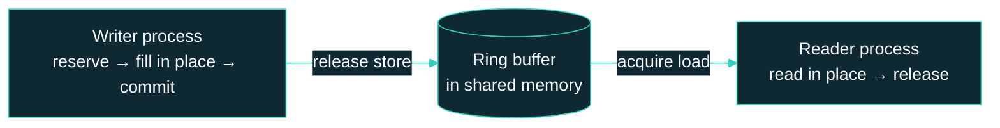

<p align="center"></p>

<p align="center">
  <a href="https://github.com/SemyonZamiakin/CorundumHFT/actions/workflows/ci.yml"></a>
  
  
  
</p>

<h3 align="center">Nanosecond IPC between processes.<br>Zero copies. No locks. No system calls on the hot path.</h3>

<p align="center">
  <a href="#quick-start">Quick start</a> ·
  <a href="#whats-new-in-120">What's new</a> ·
  <a href="#benchmarks">Benchmarks</a> ·
  <a href="docs/DESIGN.md">Design</a> ·
  <a href="docs/WIRE.md">Binary layouts</a> ·
  <a href="#testing">What is tested</a> ·
  <a href="README.uk.md">Українська</a>
</p>

<p align="center"></p>

## Overview & Use Cases

> **In one sentence:** Corundum moves messages between two processes on the same machine through shared memory in tens of nanoseconds, with no copies, no locks and no system calls on the hot path.

**Why it exists.** Pipes and sockets copy every message into the kernel and back out, and every transfer is a system call: microseconds per message. When a background service produces thousands of updates per second, or a GUI has to show a daemon's data the instant it changes, that overhead dominates. Corundum gives both processes the same ring buffer in memory: the writer builds each message in place, the reader uses it in place, and they coordinate with one acquire load and one release store per side.

<table>
  <tr>
    <td width="33%" valign="top"><b>Daemon → GUI telemetry</b><br><sub>A background collector streams samples to a dashboard. This is how Euclase Monitor feeds Euclase Light.</sub></td>
    <td width="33%" valign="top"><b>High-rate data feeds</b><br><sub>Capture, decoding or sensor processes that hand data to one consumer which must keep up without being slowed down.</sub></td>
    <td width="33%" valign="top"><b>Isolation without the latency tax</b><br><sub>Move a crash-prone part (a plugin, a decoder) into its own process and keep communication fast.</sub></td>
  </tr>
  <tr>
    <td width="33%" valign="top"><b>Logging and tracing pipelines</b><br><sub>The hot path writes records in place; a separate process compresses, filters or stores them.</sub></td>
    <td width="33%" valign="top"><b>One API, two systems</b><br><sub>The same code runs on Linux (POSIX shm + futex) and Windows (named mapping + event).</sub></td>
    <td width="33%" valign="top"><b>Learn lock-free design</b><br><sub>A small codebase, a design document that walks through the memory-ordering argument, and a benchmark to see the numbers yourself.</sub></td>
  </tr>
</table>



**New here?** Start with the [Quick start](#quick-start) (ten lines of C or C++), then [docs/DESIGN.md](docs/DESIGN.md) explains step by step why it is correct.

<p align="center"></p>

# Corundum HFT

A zero-copy, lock-free ring buffer in shared memory for passing high-frequency telemetry between processes on **Linux and Windows**, for example from a background monitoring daemon to a GUI.

## What's new in 1.2.0

- **Latency microbenchmarks.** `corundum-bench` gained two modes. `oneway` measures one-way latency directly: the writer stamps each packet with the CPU's cycle counter, the reader in another process stamps its arrival. `ops` measures what the hot-path calls cost by themselves, in one thread. The ping-pong now prints the round trip as well as round trip / 2, and every hot loop reports how often the OS switched the thread out. [Results below.](#benchmarks)
- **Zero-copy integrity tests.** `test_layout` checks the 128-byte separation of producer and consumer fields at compile time and at run time, records which header bytes each side's hot path actually writes (the producer writes only its block, the consumer only its block, and the reader never writes into the data region), fills the ring to overflow for 133 record sizes from several start offsets, and runs both positions across the 2^64 wrap. `test_concurrency` runs a producer and a consumer thread on one mapping so ThreadSanitizer can check the acquire/release pairing; weakening any of the four orderings makes it fail.
- **Checked binary layouts.** New header [`corundum/wire.h`](include/corundum/wire.h): `CRD_WIRE_PACKED` fails to compile if a struct has padding, a misaligned field or too much alignment; `CRD_WIRE_SIZE` and `CRD_WIRE_OFFSET` pin the layout; `CRD_MSG_AS` gives a typed view of a record in place. Market-data example, byte-exact tests and a guide: [docs/WIRE.md](docs/WIRE.md).
- Additions only: the existing API is unchanged and the shared layout too (`CRD_LAYOUT_VERSION` stays 1), so 1.0, 1.1 and 1.2 processes interoperate. Details in the [CHANGELOG](CHANGELOG.md).

## Features

- **Zero-copy in both directions.** `crd_reserve` returns a pointer into the ring, you fill it, `crd_commit` publishes it. `crd_read` returns a pointer to the record in place.
- **No syscalls, locks or heap on the hot path.** The hot path is a handful of inline functions in the header. The library never calls `malloc`, not even during setup: handles are plain structs you place anywhere.
- **Variable-size records** up to half the ring capacity, 8-byte aligned, each with a 32-bit user type. A record never wraps around the end of the buffer, so it is always one contiguous block.
- **Batching on both sides:** stage several records and publish once, read several records and release once.
- **Linux and Windows, one API.** The hot path is the same code on both; only setup and sleeping differ (POSIX shm + futex on Linux, named file mapping + event on Windows).
- **Optional blocking.** `crd_wait` sleeps on a futex (Windows: an event) while the ring is empty. `crd_notify` costs one memory fence and enters the kernel only if the reader is actually asleep.
- **Robust against the peer.** The reader validates every record header, so a buggy or hostile writer cannot make it read outside the mapping. A crashed writer's slot is reclaimed automatically, and data it published stays readable.
- **C and C++.** A C11 core, plus a C++17 header with RAII endpoints, typed writes, in-place construction (`try_emplace<T>`) and typed zero-copy reads (`msg.as<T>()`).
- **Checked binary layouts.** `corundum/wire.h` rejects padded or misaligned structs at compile time, so a record can be read in place by any process that includes the same header. See [docs/WIRE.md](docs/WIRE.md).
- **Tooling:** `corundum-inspect` shows a ring's fill level and who is attached; `corundum-bench` measures round-trip, one-way and per-call latency and throughput, against a pipe and a Unix socket, on your machine.

## Quick start

```c
#include <corundum/corundum.h>

/* daemon: create the ring once, then write */
crd_create("/telemetry", 1 << 20, 0600, CRD_CREATE_REPLACE);
crd_writer w;
crd_writer_open(&w, "/telemetry", CRD_OPEN_PREFAULT);

struct sample *s;
if (crd_reserve(&w, sizeof *s, (void **)&s) == CRD_OK) {   /* CRD_FULL: reader is behind */
    s->cpu = read_cpu();                                  /* written straight into shared memory */
    crd_commit(&w, sizeof *s, MSG_SAMPLE);
    crd_notify(&w);                                       /* only needed if the reader may sleep */
}
```

```c
/* GUI: read in place */
crd_reader r;
crd_reader_open(&r, "/telemetry", 0);
while (crd_wait(&r, -1) == CRD_OK) {          /* sleeps on a futex while empty */
    crd_msg m;
    while (crd_read(&r, &m) == CRD_OK)
        draw((const struct sample *)m.data);  /* no copy */
    crd_release(&r);                          /* hand the space back to the writer */
}
```

The same in C++:

```cpp
#include <corundum/corundum.hpp>

corundum::Writer w("/telemetry");
w.try_emplace<Sample>(MSG_SAMPLE, read_cpu(), now());   // constructed inside the ring

corundum::Reader r("/telemetry");
corundum::Message m;
while (r.try_read(m))
    if (const Sample *s = m.as<Sample>()) draw(*s);
r.release();
```

A complete daemon / viewer pair that streams per-core CPU load at 1 kHz is in [examples/](examples/) (Linux).

**Used in production by** [Euclase Monitor](https://github.com/SemyonZamiakin/EuclaseMonitor) 1.1, which publishes its metrics on a Corundum ring, and [Euclase Light](https://github.com/SemyonZamiakin/EuclaseLight) 1.1, whose "colour follows system load" mode reads them.

## API at a glance

| Call | What it does | Syscalls |
|---|---|---|
| `crd_create(name, capacity, mode, flags)` | Creates a segment with an empty ring (capacity: power of two, 4 KiB to 4 GiB) | yes |
| `crd_writer_open` / `crd_reader_open` | Attach as the single producer / consumer | yes |
| `crd_reserve(w, size, &ptr)` | Room for `size` bytes, pointer into shared memory | no |
| `crd_commit(w, size, type)` | Publish the reserved record | no |
| `crd_stage` + `crd_publish` | Publish several records with one store | no |
| `crd_write(w, type, src, size)` | Copying convenience | no |
| `crd_read(r, &msg)` | Next record, in place | no |
| `crd_release(r)` | Free everything read so far | no |
| `crd_notify(w)` / `crd_wait(r, timeout)` | Optional futex wake-up / sleep | only when sleeping |
| `crd_writer_close` / `crd_reader_close` / `crd_unlink` | Detach / remove the name | yes |
| `crd_inspect(name, &info)` | Read-only snapshot for monitoring | yes |

All functions return a `crd_status`; negative values are errors and `crd_strerror` describes them. The full contract is in [corundum.h](include/corundum/corundum.h).

## Benchmarks

`corundum-bench` runs every cross-process test between two processes pinned to separate cores, with 64-byte messages:

- **latency** — ping-pong: process A writes, process B echoes, A measures the round trip. Reported as the round trip and as round trip / 2.
- **oneway** — the writer stamps each packet with the CPU cycle counter just before committing it; the reader in the other process reads the counter right after `crd_read` returns. The writer sends the next packet only after the previous one is released, so there is never a queue. This needs a counter that is synchronised across cores (the invariant TSC on a single-socket x86-64 machine, the generic timer on arm64); the benchmark counts any sample whose receive time is earlier than its send time.
- **ops** — writes and reads in one thread, so no cache line moves between cores: the instruction cost of `reserve + fill + commit` and `read + use + release`.
- **throughput** — a one-way stream in which the producer writes every byte and the consumer touches every cache line.

Every hot loop also reports how often the operating system switched the thread out (Linux: `getrusage`, voluntary and involuntary; Windows: the thread's context-switch counter). These are read before and after the loop, never inside it. Raw output of every run quoted here is in [docs/bench/](docs/bench/).

### Windows 11, bare metal

Intel Core i9-9900K, Windows 11, MinGW-w64 GCC 15, Release build, `corundum-bench all -n 1000000 -c 2,4` and two more runs of the latency modes. Ranges are over the three runs.

| 64-byte message | p50 | p99 | p99.9 |
|---|---:|---:|---:|
| Corundum round trip | 151–154 ns | 214–224 ns | 273–296 ns |
| Corundum round trip / 2 | **76 ns** | 107–112 ns | 137–148 ns |
| Corundum one-way, measured directly | 93–97 ns | 129–133 ns | 164–245 ns |
| pipe (`CreatePipe`) round trip / 2, first run | 7.3 µs | 205 µs | 2.4 ms |

| Hot-path cost, one thread, 64-byte packet | ns per packet |
|---|---:|
| write: `reserve` + fill + `commit` | 8.0–8.2 |
| read: `read` + use + `release` | 4.5–4.8 |
| write and read the same packet | 8.7–9.2 |

| Throughput | 16 B | 64 B | 256 B | 1 KiB | 4 KiB |
|---|---:|---:|---:|---:|---:|
| Corundum, M msg/s | 154 | 168 | 86 | 22.3 | 5.3 |
| Corundum, GB/s | 2.5 | 10.8 | 21.9 | 22.8 | 21.7 |
| pipe, GB/s | < 0.01 | 0.02 | 0.10 | 0.32 | 1.1 |

**No system calls on the hot path.** The hot path is inline code in the header that makes no system calls. Over one million ping-pong round trips (about 0.19 s of spinning) the pinging thread was switched out 0, 2 and 14 times in the three runs. Those switches are the Windows scheduler preempting a busy thread, not calls into the kernel, and they produce the rare millisecond-scale maxima in the raw output.

### Linux (WSL2)

The same i9-9900K under **WSL2** (Ubuntu, kernel 6.18, GCC 15, Release build `-O3`), the same commands:

| 64-byte message | p50 | p99 | p99.9 |
|---|---:|---:|---:|
| Corundum round trip | 144–163 ns | 219–227 ns | 277–295 ns |
| Corundum round trip / 2 | 72–81 ns | 110–114 ns | 139–148 ns |
| Corundum one-way, measured directly | 91–94 ns | 120–125 ns | 3.7–6.8 µs |
| pipe round trip / 2, first run | 21.7 µs | 41.0 µs | 78.0 µs |
| Unix socket round trip / 2, first run | 20.2 µs | 44.9 µs | 83.9 µs |

| Hot-path cost, one thread, 64-byte packet | ns per packet |
|---|---:|
| write: `reserve` + fill + `commit` | 8.3–8.5 |
| read: `read` + use + `release` | 4.4–4.6 |
| write and read the same packet | 8.4–8.7 |

| Throughput | 16 B | 64 B | 256 B | 1 KiB | 4 KiB |
|---|---:|---:|---:|---:|---:|
| Corundum, M msg/s | 192 | 167 | 89 | 25.9 | 5.8 |
| Corundum, GB/s | 3.1 | 10.7 | 22.8 | 26.5 | 23.7 |
| pipe, GB/s | 0.08 | 0.31 | 1.0 | 3.0 | 6.2 |
| Unix socket, GB/s | 0.03 | 0.11 | 0.42 | 1.5 | 4.0 |

In every Corundum hot loop of all three runs (ping-pong, both sides of the one-way test, the single-thread test) Linux counted **0 voluntary context switches**: the threads never blocked in the kernel. Involuntary switches (preemption by the scheduler) were between 0 and 4 per loop.

How to read these numbers:

- **Round trip / 2 is the figure to compare with other IPC benchmarks**, and on bare-metal Windows it is 76 ns at the median (1.1.0 reported 74 ns). It assumes both directions cost the same.
- **The directly measured one-way latency is higher, 91–97 ns.** It includes reading the cycle counter on both cores (with fences, so the reads stay in order), and every packet starts from an idle ring. Both figures are real; they measure slightly different things.
- **The hot-path calls cost about 8 ns to write and 4.5 ns to read a 64-byte packet** when no cache line has to move. Almost all of the cross-process latency is the cache-coherence transfer between cores, which no software design can avoid.
- WSL2 is a virtual machine: its vCPUs do not map to fixed physical cores, minima as low as 16 ns there are not physically meaningful, and the one-way p99.9 shows hypervisor interruptions. The pipe and socket figures include the hypervisor's wake-up cost. A bare-metal Linux measurement has not been done.
- Corundum's readers in these tests busy-poll. A reader that sleeps in `crd_wait` pays a futex (Windows: event) wake-up, which is comparable to a pipe; that path is not benchmarked here.
- CI runs the benchmark on GitHub's x86-64, arm64 and Windows runners on every push (shared VMs, so treat their numbers as a smoke test).

## Guarantees and limits

- **One writer and one reader per ring.** Attaching a second one fails with `CRD_EBUSY`. For several consumers, create one ring per consumer.
- **Records are delivered in order, complete and exactly once** while both processes are alive. A record is visible to the reader only after it is committed in full. If the reader crashes, records it read but did not release are delivered again to the next reader.
- **The writer never blocks.** If the reader falls behind, `crd_reserve` returns `CRD_FULL` and the writer decides whether to drop, retry or buffer. This suits telemetry, where fresh data matters more than old data.
- **Shared memory is shared.** The reader validates record headers, but payload bytes stay writable by the writer. If you do not trust the writer, copy the payload before validating it. See [SECURITY.md](SECURITY.md).
- **Both processes must use the same ABI:** 64-bit, GCC or Clang (MinGW-w64 on Windows), and the same Corundum layout version (checked when attaching).
- **Not a persistence layer.** On Linux a segment lives in RAM (`/dev/shm`) until `crd_unlink` or reboot. On Windows the mapping `Local\corundum.<name>` belongs to the current logon session and exists while any process has it open; the creating process keeps it alive until `crd_unlink` or exit.

## Building

Requirements: CMake 3.16+ and GCC or Clang. Linux: tested in CI with GCC 11, 13 and Clang 18, locally with GCC 15 and Clang 21. Windows: MinGW-w64 GCC from [MSYS2](https://www.msys2.org), tested in CI and locally with GCC 15.

```bash
cmake -S . -B build -DCMAKE_BUILD_TYPE=Release
cmake --build build -j
ctest --test-dir build --output-on-failure
sudo cmake --install build      # optional: headers, libcorundum.a, CMake package, corundum-inspect
```

On Windows, from an MSYS2 MinGW shell or with `C:\msys64\mingw64\bin` on `PATH`, add `-G "MinGW Makefiles"` to the first command. Projects that do not use CMake can compile `src/corundum.c` as C11 and link it; the hot path is header-only.

In your project: `find_package(Corundum REQUIRED)` and `target_link_libraries(app PRIVATE Corundum::corundum)`, or add this repository with `add_subdirectory`.

## Testing

| Suite | What it covers |
|---|---|
| `test_ring` (907 checks on Linux, 905 on Windows) | Argument validation, foreign or half-initialised segments, exclusive roles and stale-owner recovery, full/empty boundaries, maximum-size records at every wrap position, staging, 400 000 random interleaved operations, corruption detection, close and timeout semantics |
| `test_layout` | Cache-line separation: compile-time and run-time checks that metadata, producer-written and consumer-written fields sit in separate 128-byte blocks (so also on separate 64-byte lines); page-aligned mappings and 8-byte-aligned records. Write sets: snapshots of the header around each hot-path call prove the producer writes only its block, the consumer only its block, and the reader never writes into the data region. Overflow: the ring filled to `CRD_FULL` for 133 record sizes (0 to 2040 bytes) from 3 start offsets each; every refusal is a real full condition, changes nothing, and every record reads back intact. Positions: 4 000 operations across the 2^64 wrap of both 64-bit positions |
| `test_concurrency` | A producer and a consumer thread on one shared mapping: 3.5 million variable-size records through a tiny ring (constantly full), a ring of maximum-size records and a large batched ring, every byte verified. Under ThreadSanitizer it checks the acquire/release pairing on `head` and `tail` |
| `test_ipc` | 3 million variable-size records between two processes, every byte verified; 20 000 records to a sleeping reader with no lost wake-ups; a writer killed mid-stream (`SIGKILL` / `TerminateProcess`) |
| `test_wire`, `test_wire_cpp` | Binary layouts: the expected bytes of a quote built by hand and compared with what the reader sees in the ring at every buffer offset; typed views refuse records of the wrong size; the same layouts from C++ with `try_emplace` and `as<T>()` |
| `wire_compile_fail_0..7` | Seven programs with a padded, misaligned, over-aligned, incompletely listed, resized or shifted struct must fail to compile; the control program must compile |
| `test_cpp` | The C++ wrapper: typed and in-place writes, typed reads, move semantics, exceptions, a producer thread with `wait` |

`scripts/check.sh` runs everything with GCC (`-Werror`), again with Clang under AddressSanitizer and UndefinedBehaviorSanitizer, and runs the threaded tests under ThreadSanitizer. CI repeats this on Linux x86-64 and **arm64** (whose weaker memory model is where a missing acquire or release would show up) and runs the whole suite on **Windows** with MinGW-w64.

### What has been verified, and what has not

Verified for 1.2.0:

- Builds without warnings (`-Wall -Wextra -Wpedantic -Wshadow -Wconversion -Werror`) and passes all 15 CTest entries with GCC 15 and Clang 21 on Linux (WSL2) and with MinGW-w64 GCC 15 on Windows 11; ASan + UBSan and TSan runs are clean.
- The concurrency test detects broken memory ordering: changing any one of the four orderings (publish store of `head`, release store of `tail`, the reader's load of `head`, the writer's load of `tail`) from release/acquire to relaxed makes ThreadSanitizer report a data race. This mutation check was run by hand; it is not part of CI.
- Each side's hot path writes only its own cache-line block (`test_layout`).
- In the benchmark hot loops Linux counted no voluntary context switches, so the threads never blocked in the kernel. The benchmark numbers above come from one machine, an i9-9900K.

Not verified:

- No bare-metal Linux numbers, no AMD or other Intel CPUs, no multi-socket machines. On a multi-socket machine the TSC may not be synchronised across sockets, and the `oneway` mode would then be invalid (it reports samples that arrive "before" they were sent).
- arm64 is tested only on GitHub's CI runners; nothing was measured on arm64 hardware. Windows on arm64 has not been tested at all.
- The absence of false sharing is shown structurally (field offsets and the bytes each side writes), not with hardware counters (for example `perf c2c`).
- "No system calls on the hot path" is established from the code and the context-switch counts; system calls were not traced (`strace`, ETW). Non-blocking system calls would not show up as context switches; the hot-path functions contain none.
- The `crd_wait` / `crd_notify` sleeping path is tested for correctness (no lost wake-ups) but its latency is not benchmarked.

## How it works

The segment is a 512-byte header followed by the data region. The producer's position, the consumer's position and the immutable metadata each sit on their own 128-byte block, so the two processes never write to the same cache line. Each side keeps a private copy of the other's position and rereads the shared one only when the ring looks full or empty, so in steady state most operations touch no shared line at all.

The full protocol, the memory-ordering argument and the futex handshake are in [docs/DESIGN.md](docs/DESIGN.md).

## Project

Corundum HFT is developed by **Euclase**. Issues and pull requests are welcome; see [CONTRIBUTING.md](CONTRIBUTING.md). Licensed under the [MIT License](LICENSE).
