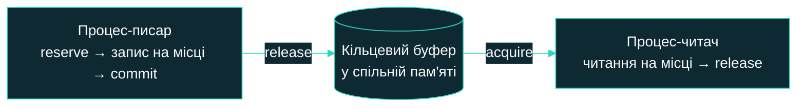

<p align="center"></p>

<p align="center">
  <a href="https://github.com/SemyonZamiakin/CorundumHFT/actions/workflows/ci.yml"></a>
  
  
  
</p>

<h3 align="center">IPC між процесами за наносекунди.<br>Без копіювання. Без блокувань. Без системних викликів на гарячому шляху.</h3>

<p align="center">
  <a href="#швидкий-старт">Швидкий старт</a> ·
  <a href="#що-нового-в-120">Що нового</a> ·
  <a href="#вимірювання-продуктивності">Продуктивність</a> ·
  <a href="docs/DESIGN.uk.md">Архітектура</a> ·
  <a href="docs/WIRE.uk.md">Бінарні формати</a> ·
  <a href="#тестування">Що перевірено</a> ·
  <a href="README.md">English</a>
</p>

<p align="center"></p>

## Огляд і сценарії використання

> **Одним реченням:** Corundum передає повідомлення між двома процесами на одній машині через спільну пам'ять за десятки наносекунд, без копіювання, без блокувань і без системних викликів на гарячому шляху.

**Навіщо це.** Канали й сокети копіюють кожне повідомлення в ядро і назад, а кожна передача є системним викликом: мікросекунди на повідомлення. Коли фонова служба видає тисячі оновлень на секунду або графічний застосунок має миттєво показувати дані демона, ці витрати стають головними. Corundum дає обом процесам один кільцевий буфер у пам'яті: писар формує повідомлення на місці, читач використовує його на місці, і вони узгоджуються одним завантаженням з acquire та одним записом з release на кожному боці.

<table>
  <tr>
    <td width="33%" valign="top"><b>Телеметрія «демон → GUI»</b><br><sub>Фоновий збирач передає дані на панель. Саме так Euclase Monitor живить Euclase Light.</sub></td>
    <td width="33%" valign="top"><b>Потоки даних з високою частотою</b><br><sub>Процеси захоплення, декодування чи обробки датчиків, що віддають дані одному споживачу, який має встигати.</sub></td>
    <td width="33%" valign="top"><b>Ізоляція без втрати швидкості</b><br><sub>Винесіть нестабільну частину (плагін, декодер) в окремий процес і збережіть швидкий зв'язок.</sub></td>
  </tr>
  <tr>
    <td width="33%" valign="top"><b>Журналювання і трасування</b><br><sub>Гарячий шлях пише записи на місці, окремий процес стискає, фільтрує або зберігає їх.</sub></td>
    <td width="33%" valign="top"><b>Один API для двох систем</b><br><sub>Той самий код працює в Linux (POSIX shm + futex) і Windows (іменоване відображення + подія).</sub></td>
    <td width="33%" valign="top"><b>Вивчити lock-free підхід</b><br><sub>Невеликий код, документ з покроковим обґрунтуванням порядку операцій з пам'яттю і бенчмарк, щоб побачити цифри самому.</sub></td>
  </tr>
</table>



**Тільки починаєте?** Почніть зі [швидкого старту](#швидкий-старт) (десять рядків на C або C++), а [docs/DESIGN.uk.md](docs/DESIGN.uk.md) покроково пояснює, чому це коректно.

<p align="center"></p>

# Corundum HFT

Кільцевий буфер без копіювання та без блокувань у спільній пам'яті. Він передає високочастотну телеметрію між процесами в **Linux і Windows**, наприклад від фонового демона-монітора до графічного застосунку.

## Що нового в 1.2.0

- **Мікробенчмарки затримки.** `corundum-bench` отримав два режими. `oneway` вимірює односторонню затримку напряму: писар ставить на кожен пакет позначку лічильника тактів процесора, читач в іншому процесі фіксує момент отримання. `ops` вимірює, скільки коштують самі виклики гарячого шляху, в одному потоці. Пінг-понг тепер показує і повний оберт, і оберт / 2, а кожен гарячий цикл звітує, скільки разів ОС знімала потік з ядра. [Результати нижче.](#вимірювання-продуктивності)
- **Тести цілісності zero-copy.** `test_layout` перевіряє розділення полів писаря і читача по 128-байтових блоках під час компіляції та виконання, фіксує, які байти заголовка насправді пише гарячий шлях кожної сторони (писар пише лише свій блок, читач лише свій і ніколи не пише в область даних), заповнює кільце до переповнення для 133 розмірів запису з кількох початкових зміщень і проводить обидві позиції через переповнення 2^64. `test_concurrency` запускає потоки писаря і читача на одному відображенні, щоб ThreadSanitizer перевірив пари acquire/release; послаблення будь-якого з чотирьох упорядкувань змушує тест впасти.
- **Перевірені бінарні формати.** Новий заголовок [`corundum/wire.h`](include/corundum/wire.h): `CRD_WIRE_PACKED` не компілюється, якщо структура має паддінг, невирівняне поле або завелике вирівнювання; `CRD_WIRE_SIZE` і `CRD_WIRE_OFFSET` фіксують розкладку; `CRD_MSG_AS` дає типізований погляд на запис на місці. Приклад ринкових даних, побайтові тести й посібник: [docs/WIRE.uk.md](docs/WIRE.uk.md).
- Лише доповнення: наявний API не змінився, спільна розкладка теж (`CRD_LAYOUT_VERSION` лишається 1), тож процеси 1.0, 1.1 і 1.2 працюють разом. Подробиці в [CHANGELOG](CHANGELOG.md).

## Можливості

- **Без копіювання в обидва боки.** `crd_reserve` повертає вказівник усередину буфера, ви заповнюєте його, `crd_commit` публікує запис. `crd_read` повертає вказівник на запис на місці.
- **Гарячий шлях без системних викликів, блокувань і купи.** Гарячий шлях складається з кількох inline-функцій у заголовку. Бібліотека ніколи не викликає `malloc`, навіть під час налаштування: дескриптори є звичайними структурами, які можна розмістити будь-де.
- **Записи змінної довжини** до половини місткості буфера, вирівняні на 8 байтів, кожен із 32-бітним типом користувача. Запис ніколи не переходить через кінець буфера, тому завжди лежить одним суцільним блоком.
- **Пакетна обробка з обох боків:** можна підготувати кілька записів і опублікувати їх одним разом, прочитати кілька записів і звільнити їх одним разом.
- **Linux і Windows, один API.** Гарячий шлях однаковий на обох системах; відрізняються лише налаштування й сон (POSIX shm + futex у Linux, іменоване відображення + подія у Windows).
- **Необов'язкове блокування.** `crd_wait` засинає на futex (у Windows на події), поки буфер порожній. `crd_notify` коштує один бар'єр пам'яті й заходить у ядро лише тоді, коли читач справді спить.
- **Стійкість до іншої сторони.** Читач перевіряє заголовок кожного запису, тому помилковий чи зловмисний писар не змусить його читати поза відображенням. Слот писаря, що впав, звільняється автоматично, а опубліковані ним дані лишаються доступними.
- **C і C++.** Ядро на C11 і заголовок C++17 з RAII-кінцевими точками, типізованим записом, побудовою об'єкта на місці (`try_emplace<T>`) і типізованим читанням без копіювання (`msg.as<T>()`).
- **Перевірені бінарні формати.** `corundum/wire.h` відхиляє структури з паддінгом чи невирівняними полями ще під час компіляції, тож запис можна читати на місці в будь-якому процесі, що підключає той самий заголовок. Див. [docs/WIRE.uk.md](docs/WIRE.uk.md).
- **Інструменти:** `corundum-inspect` показує заповненість буфера і підключені процеси; `corundum-bench` вимірює затримку обороту, односторонню затримку, вартість викликів і пропускну здатність порівняно з pipe і Unix-сокетом на вашій машині.

## Швидкий старт

```c
#include <corundum/corundum.h>

/* демон: створити буфер один раз і писати */
crd_create("/telemetry", 1 << 20, 0600, CRD_CREATE_REPLACE);
crd_writer w;
crd_writer_open(&w, "/telemetry", CRD_OPEN_PREFAULT);

struct sample *s;
if (crd_reserve(&w, sizeof *s, (void **)&s) == CRD_OK) {   /* CRD_FULL: читач відстає */
    s->cpu = read_cpu();                                  /* пишемо одразу в спільну пам'ять */
    crd_commit(&w, sizeof *s, MSG_SAMPLE);
    crd_notify(&w);                                       /* потрібно, лише якщо читач може спати */
}
```

```c
/* GUI: читання на місці */
crd_reader r;
crd_reader_open(&r, "/telemetry", 0);
while (crd_wait(&r, -1) == CRD_OK) {          /* спить на futex, поки порожньо */
    crd_msg m;
    while (crd_read(&r, &m) == CRD_OK)
        draw((const struct sample *)m.data);  /* без копіювання */
    crd_release(&r);                          /* повернути місце писарю */
}
```

Те саме на C++:

```cpp
#include <corundum/corundum.hpp>

corundum::Writer w("/telemetry");
w.try_emplace<Sample>(MSG_SAMPLE, read_cpu(), now());   // об'єкт будується всередині буфера

corundum::Reader r("/telemetry");
corundum::Message m;
while (r.try_read(m))
    if (const Sample *s = m.as<Sample>()) draw(*s);
r.release();
```

Повна пара демон / переглядач, що передає завантаження кожного ядра процесора з частотою 1 кГц, лежить у [examples/](examples/) (Linux).

**Використовується в** [Euclase Monitor](https://github.com/SemyonZamiakin/EuclaseMonitor) 1.1, який публікує свої метрики в кільце Corundum, і [Euclase Light](https://github.com/SemyonZamiakin/EuclaseLight) 1.1, чий режим «колір за навантаженням» їх читає.

## Коротко про API

| Виклик | Що робить | Системні виклики |
|---|---|---|
| `crd_create(name, capacity, mode, flags)` | Створює сегмент з порожнім буфером (місткість: степінь двійки, від 4 КіБ до 4 ГіБ) | так |
| `crd_writer_open` / `crd_reader_open` | Підключення як єдиний писар / єдиний читач | так |
| `crd_reserve(w, size, &ptr)` | Місце під `size` байтів, вказівник у спільну пам'ять | ні |
| `crd_commit(w, size, type)` | Опублікувати зарезервований запис | ні |
| `crd_stage` + `crd_publish` | Опублікувати кілька записів одним записом у пам'ять | ні |
| `crd_write(w, type, src, size)` | Зручна обгортка з копіюванням | ні |
| `crd_read(r, &msg)` | Наступний запис, на місці | ні |
| `crd_release(r)` | Звільнити все прочитане | ні |
| `crd_notify(w)` / `crd_wait(r, timeout)` | Необов'язкове пробудження / сон на futex | лише коли читач спить |
| `crd_writer_close` / `crd_reader_close` / `crd_unlink` | Від'єднатися / видалити ім'я | так |
| `crd_inspect(name, &info)` | Знімок стану лише для читання, для моніторингу | так |

Усі функції повертають `crd_status`; від'ємні значення означають помилки, `crd_strerror` описує їх. Повний контракт описано в [corundum.h](include/corundum/corundum.h).

## Вимірювання продуктивності

`corundum-bench` проводить кожен міжпроцесний тест між двома процесами, закріпленими за різними ядрами, з повідомленнями по 64 байти:

- **latency** — пінг-понг: процес A пише, процес B відсилає назад, A вимірює повний оберт. Показується повний оберт і оберт / 2.
- **oneway** — писар ставить на пакет позначку лічильника тактів процесора безпосередньо перед публікацією; читач в іншому процесі зчитує лічильник одразу після повернення з `crd_read`. Наступний пакет іде лише після звільнення попереднього, тож черги ніколи немає. Потрібен лічильник, синхронізований між ядрами (інваріантний TSC на однопроцесорній машині x86-64, generic timer на arm64); бенчмарк рахує кожен вимір, у якому час отримання менший за час відправлення.
- **ops** — запис і читання в одному потоці, тож жодна кеш-лінія не переходить між ядрами: це вартість інструкцій `reserve + заповнення + commit` і `read + використання + release`.
- **throughput** — односпрямований потік, у якому писар записує кожен байт, а читач торкається кожної кеш-лінії.

Кожен гарячий цикл також показує, скільки разів операційна система знімала потік з ядра (Linux: `getrusage`, добровільні та вимушені перемикання; Windows: лічильник перемикань контексту потоку). Значення зчитуються до і після циклу, ніколи всередині. Повний вивід кожного запуску, наведеного тут, лежить у [docs/bench/](docs/bench/).

### Windows 11, без віртуалізації

Intel Core i9-9900K, Windows 11, MinGW-w64 GCC 15, збірка Release, `corundum-bench all -n 1000000 -c 2,4` і ще два запуски режимів затримки. Діапазони — за трьома запусками.

| Повідомлення 64 B | p50 | p99 | p99.9 |
|---|---:|---:|---:|
| Corundum, повний оберт | 151–154 нс | 214–224 нс | 273–296 нс |
| Corundum, оберт / 2 | **76 нс** | 107–112 нс | 137–148 нс |
| Corundum, одностороння, виміряна напряму | 93–97 нс | 129–133 нс | 164–245 нс |
| pipe (`CreatePipe`), оберт / 2, перший запуск | 7,3 мкс | 205 мкс | 2,4 мс |

| Вартість гарячого шляху, один потік, пакет 64 B | нс на пакет |
|---|---:|
| запис: `reserve` + заповнення + `commit` | 8,0–8,2 |
| читання: `read` + використання + `release` | 4,5–4,8 |
| запис і читання того самого пакета | 8,7–9,2 |

| Пропускна здатність | 16 B | 64 B | 256 B | 1 KiB | 4 KiB |
|---|---:|---:|---:|---:|---:|
| Corundum, млн повідомлень/с | 154 | 168 | 86 | 22,3 | 5,3 |
| Corundum, ГБ/с | 2,5 | 10,8 | 21,9 | 22,8 | 21,7 |
| pipe, ГБ/с | < 0,01 | 0,02 | 0,10 | 0,32 | 1,1 |

**Без системних викликів на гарячому шляху.** Гарячий шлях — це inline-код у заголовку, який не робить системних викликів. За мільйон обертів пінг-понгу (близько 0,19 с активного очікування) потік, що надсилав пінги, знімали з ядра 0, 2 і 14 разів у трьох запусках. Це планувальник Windows витісняє зайнятий потік, а не виклики ядра; саме ці перемикання дають рідкісні максимуми порядку мілісекунд у сирому виводі.

### Linux (WSL2)

Той самий i9-9900K під **WSL2** (Ubuntu, ядро 6.18, GCC 15, збірка Release `-O3`), ті самі команди:

| Повідомлення 64 B | p50 | p99 | p99.9 |
|---|---:|---:|---:|
| Corundum, повний оберт | 144–163 нс | 219–227 нс | 277–295 нс |
| Corundum, оберт / 2 | 72–81 нс | 110–114 нс | 139–148 нс |
| Corundum, одностороння, виміряна напряму | 91–94 нс | 120–125 нс | 3,7–6,8 мкс |
| pipe, оберт / 2, перший запуск | 21,7 мкс | 41,0 мкс | 78,0 мкс |
| Unix-сокет, оберт / 2, перший запуск | 20,2 мкс | 44,9 мкс | 83,9 мкс |

| Вартість гарячого шляху, один потік, пакет 64 B | нс на пакет |
|---|---:|
| запис: `reserve` + заповнення + `commit` | 8,3–8,5 |
| читання: `read` + використання + `release` | 4,4–4,6 |
| запис і читання того самого пакета | 8,4–8,7 |

| Пропускна здатність | 16 B | 64 B | 256 B | 1 KiB | 4 KiB |
|---|---:|---:|---:|---:|---:|
| Corundum, млн повідомлень/с | 192 | 167 | 89 | 25,9 | 5,8 |
| Corundum, ГБ/с | 3,1 | 10,7 | 22,8 | 26,5 | 23,7 |
| pipe, ГБ/с | 0,08 | 0,31 | 1,0 | 3,0 | 6,2 |
| Unix-сокет, ГБ/с | 0,03 | 0,11 | 0,42 | 1,5 | 4,0 |

У кожному гарячому циклі Corundum в усіх трьох запусках (пінг-понг, обидві сторони одностороннього тесту, однопотоковий тест) Linux нарахував **0 добровільних перемикань контексту**: потоки жодного разу не блокувалися в ядрі. Вимушених перемикань (витіснення планувальником) було від 0 до 4 за цикл.

Як читати ці числа:

- **Оберт / 2 — це число для порівняння з іншими бенчмарками IPC**; на Windows без віртуалізації медіана 76 нс (у 1.1.0 було 74 нс). Воно припускає, що обидва напрями коштують однаково.
- **Одностороння затримка, виміряна напряму, вища: 91–97 нс.** Вона включає читання лічильника тактів на обох ядрах (з бар'єрами, щоб зчитування не переставлялися), і кожен пакет стартує з простою кільця. Обидва числа справжні; вони вимірюють трохи різне.
- **Виклики гарячого шляху коштують близько 8 нс на запис і 4,5 нс на читання пакета 64 B**, коли кеш-лінії не треба переносити. Майже вся міжпроцесна затримка — це передача кеш-лінії між ядрами за протоколом когерентності, якої не уникне жоден програмний дизайн.
- WSL2 — це віртуальна машина: її vCPU не прив'язані до фіксованих фізичних ядер, мінімуми близько 16 нс там фізично не мають сенсу, а p99.9 одностороннього тесту показує переривання гіпервізора. Числа pipe і сокета включають вартість пробудження через гіпервізор. Вимірювань на Linux без віртуалізації ще не було.
- Читачі Corundum у цих тестах активно опитують кільце. Читач, що спить у `crd_wait`, платить за пробудження через futex (у Windows через подію), і це порівнянно з pipe; цей шлях тут не вимірювався.
- CI запускає бенчмарк на раннерах GitHub x86-64, arm64 і Windows при кожному push (спільні віртуальні машини, тож їхні числа — лише димовий тест).

## Гарантії та обмеження

- **Один писар і один читач на буфер.** Друге підключення в тій самій ролі повертає `CRD_EBUSY`. Для кількох читачів створіть окремий буфер для кожного.
- **Записи доставляються по порядку, цілими і рівно один раз,** поки обидва процеси працюють. Читач бачить запис лише після його повного підтвердження. Якщо читач впав, записи, які він прочитав, але не звільнив, буде доставлено наступному читачу ще раз.
- **Писар ніколи не блокується.** Якщо читач відстає, `crd_reserve` повертає `CRD_FULL`, і писар сам вирішує: відкинути дані, повторити чи буферизувати. Це підходить для телеметрії, де свіжі дані важливіші за старі.
- **Спільна пам'ять спільна.** Читач перевіряє заголовки записів, але байти даних писар може змінювати й далі. Якщо писарю немає довіри, скопіюйте дані перед перевіркою. Див. [SECURITY.md](SECURITY.md).
- **Обидва процеси мають використовувати однаковий ABI:** 64 біти, GCC або Clang (у Windows MinGW-w64) і ту саму версію розмітки Corundum (перевіряється під час підключення).
- **Це не сховище.** У Linux сегмент живе в оперативній пам'яті (`/dev/shm`) до `crd_unlink` або перезавантаження. У Windows відображення `Local\corundum.<ім'я>` належить поточному сеансу входу й існує, поки його відкрито хоча б в одному процесі; процес-творець тримає його до `crd_unlink` або свого завершення.

## Збірка

Потрібні CMake 3.16+ і GCC або Clang. Linux: у CI перевірено GCC 11, 13 і Clang 18, локально GCC 15 і Clang 21. Windows: MinGW-w64 GCC з [MSYS2](https://www.msys2.org), перевірено в CI та локально з GCC 15.

```bash
cmake -S . -B build -DCMAKE_BUILD_TYPE=Release
cmake --build build -j
ctest --test-dir build --output-on-failure
sudo cmake --install build      # необов'язково: заголовки, libcorundum.a, пакет CMake, corundum-inspect
```

У Windows (оболонка MSYS2 MinGW або `C:\msys64\mingw64\bin` у `PATH`) додайте `-G "MinGW Makefiles"` до першої команди. Проєкти без CMake можуть скомпілювати `src/corundum.c` як C11 і злінкувати його; гарячий шлях міститься в заголовку.

У своєму проєкті: `find_package(Corundum REQUIRED)` і `target_link_libraries(app PRIVATE Corundum::corundum)`, або підключіть цей репозиторій через `add_subdirectory`.

## Тестування

| Набір | Що перевіряє |
|---|---|
| `test_ring` (907 перевірок у Linux, 905 у Windows) | Перевірку аргументів, чужі або напівініціалізовані сегменти, виключні ролі та відновлення після мертвого власника, межі «повний / порожній», записи максимального розміру в кожній позиції переходу через кінець, підготовку записів, 400 000 випадкових чергувань операцій, виявлення пошкоджень, закриття і тайм-аути |
| `test_layout` | Розділення кеш-ліній: перевірки під час компіляції та виконання, що метадані, поля писаря і поля читача лежать в окремих 128-байтових блоках (а отже й на окремих 64-байтових лініях); відображення вирівняні на сторінку, записи на 8 байтів. Множини запису: знімки заголовка до і після кожного виклику гарячого шляху доводять, що писар пише лише свій блок, читач лише свій і ніколи не пише в область даних. Переповнення: кільце заповнюється до `CRD_FULL` для 133 розмірів запису (від 0 до 2040 байтів) з трьох початкових зміщень кожен; кожна відмова — справжній стан «повне», нічого не змінює, і кожен запис читається неушкодженим. Позиції: 4 000 операцій через переповнення 2^64 обох 64-бітних позицій |
| `test_concurrency` | Потоки писаря і читача на одному спільному відображенні: 3,5 мільйона записів змінної довжини через крихітне кільце (постійно повне), кільце з записами максимального розміру і велике кільце з пакетною обробкою, кожен байт перевіряється. Під ThreadSanitizer перевіряє пари acquire/release на `head` і `tail` |
| `test_ipc` | 3 мільйони записів змінної довжини між двома процесами з перевіркою кожного байта; 20 000 записів сплячому читачу без жодного втраченого пробудження; писаря, вбитого посеред потоку (`SIGKILL` / `TerminateProcess`) |
| `test_wire`, `test_wire_cpp` | Бінарні формати: очікувані байти котирування, побудовані вручну, порівнюються з тим, що читач бачить у кільці на кожному зміщенні буфера; типізований погляд відхиляє записи неправильного розміру; ті самі формати з C++ через `try_emplace` і `as<T>()` |
| `wire_compile_fail_0..7` | Сім програм зі структурою з паддінгом, невирівняним полем, завеликим вирівнюванням, неповним списком полів, зміненим розміром чи зміщенням мають не скомпілюватися; контрольна програма має скомпілюватися |
| `test_cpp` | Обгортку C++: типізований запис і побудову на місці, типізоване читання, переміщення, винятки, потік-писар із `wait` |

`scripts/check.sh` запускає все з GCC (`-Werror`), ще раз із Clang під AddressSanitizer та UndefinedBehaviorSanitizer, а багатопотокові тести — під ThreadSanitizer. CI повторює це в Linux на x86-64 і **arm64** (його слабша модель пам'яті якраз виявляє пропущений acquire або release) і запускає всі тести у **Windows** з MinGW-w64.

### Що перевірено, а що ні

Перевірено для 1.2.0:

- Збирається без попереджень (`-Wall -Wextra -Wpedantic -Wshadow -Wconversion -Werror`) і проходить усі 15 записів CTest з GCC 15 і Clang 21 у Linux (WSL2) та з MinGW-w64 GCC 15 у Windows 11; запуски з ASan + UBSan і TSan чисті.
- Тест конкурентності виявляє зламане впорядкування пам'яті: якщо змінити будь-яке з чотирьох упорядкувань (запис `head` при публікації, запис `tail` при звільненні, читання `head` читачем, читання `tail` писарем) з release/acquire на relaxed, ThreadSanitizer повідомляє про гонку даних. Цю мутаційну перевірку виконано вручну; вона не входить у CI.
- Гарячий шлях кожної сторони пише лише у свій блок кеш-ліній (`test_layout`).
- У гарячих циклах бенчмарка Linux не нарахував жодного добровільного перемикання контексту, тобто потоки не блокувалися в ядрі. Наведені числа отримано на одній машині, i9-9900K.

Не перевірено:

- Немає чисел для Linux без віртуалізації, для AMD чи інших процесорів Intel, для багатопроцесорних машин. На машині з кількома сокетами TSC може бути не синхронізований між сокетами, і тоді режим `oneway` некоректний (він показує виміри, що «прийшли» раніше, ніж були відправлені).
- arm64 перевірено лише на раннерах GitHub CI; на залізі arm64 нічого не вимірювалося. Windows на arm64 не тестувалася зовсім.
- Відсутність false sharing показано структурно (зміщення полів і байти, які пише кожна сторона), а не апаратними лічильниками (наприклад, `perf c2c`).
- «Без системних викликів на гарячому шляху» встановлено з коду та лічильників перемикань контексту; системні виклики не трасувалися (`strace`, ETW). Неблокувальні системні виклики не з'явилися б як перемикання контексту; у функціях гарячого шляху їх немає.
- Шлях сну `crd_wait` / `crd_notify` перевірено на коректність (без втрачених пробуджень), але його затримку не вимірювали.

## Як це працює

Сегмент складається із 512-байтового заголовка й області даних. Позиція писаря, позиція читача і незмінні метадані лежать кожна у своєму 128-байтовому блоці, тому процеси ніколи не пишуть в одну кеш-лінію. Кожна сторона тримає приватну копію позиції іншої сторони і перечитує спільне значення лише тоді, коли буфер здається повним або порожнім. Тому в усталеному режимі більшість операцій узагалі не торкається спільних ліній.

Повний протокол, обґрунтування порядку операцій з пам'яттю і рукостискання через futex описано в [docs/DESIGN.uk.md](docs/DESIGN.uk.md).

## Проєкт

Corundum HFT розробляє **Euclase**. Issues і pull requests вітаються, див. [CONTRIBUTING.md](CONTRIBUTING.md). Ліцензія [MIT](LICENSE).
